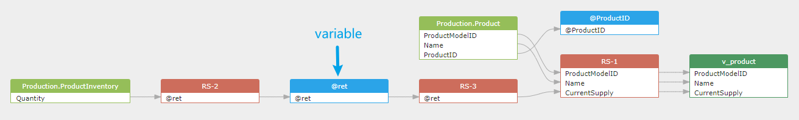

## 1 Constant

Constants used in the SQL statement will be collected and saved in a pseudo table: `constantTable`.
Each SQL statement will create a `constantTable` table to save the constants used in the SQL statement.

So SQLFlow able to generate the data flow to trace the constant value.
> Constants only will be collected when the /showConstant is set to true in the SQLFlow.
and constants used in the insert statement WILL NOT BE collected in order to avoid too many constants even if the /showConstant is set to true.

>By default, the /showConstant is set to false in the SQLFlow which means constants will not be collected.

```sql
SELECT 'constant' as field1, 2 as field2;
```

a `table` XML tag and type attribute value `constantTable`:

```xml
  <table id="5" name="SQL_CONSTANTS-1" type="constantTable">
      <column id="6" name="'constant'"/>
      <column id="8" name="2"/>
  </table>
```

### <span style="color:#8250df">SLPC v0.2 representation</span>

> [!IMPORTANT]
> SLPC does not create a persistent `constantTable` endpoint. Each pure-literal target gets a
> `Fact(axis=VALUE, role=DERIVED)` with `sourceEndpointRef=null`. Its occurrence has ordered
> `literalInputs` for the string and number, including literal kind, source location when available, and a
> policy-safe fingerprint. Secret or sensitive text is redacted; display text never becomes identity.

```sql
UPDATE table1 t1 JOIN table2 t2 ON t1.field1 = t2.field1 
SET t1.field2='constant' and t1.field3=2;
```

a `table` XML tag and type attribute value `constantTable`:

```xml
  <table id="15" name="SQL_CONSTANTS-1" type="constantTable">
      <column id="16" name="'constant'"/>
      <column id="17" name="2"/>
  </table>
```

### <span style="color:#8250df">SLPC v0.2 representation</span>

> [!IMPORTANT]
> The assignments produce two `VALUE + DERIVED` facts targeting `table1.field2` and `table1.field3`, with
> the string and number recorded as occurrence literal inputs. The update itself is
> `StatementOperation(UPDATE, MUTATION)`. The join keys independently produce `ROW + JOIN` facts and a
> `JoinSemantics` record. Literal lineage, row selection, and object mutation are therefore not conflated.

### v1 representation (schema perspective)

- In v1, constants are represented via a pseudo table `constantTable` in the
  object list (dbobjs). Each literal appears as a column under that table.
- Relations may mark synthesized sources with `source = "system"` and can
  label how the target is derived via `dependency = simple/function/expression`.
- `effectType` in v1 expresses the operation kind (e.g., `select`, `insert`,
  `update`, `merge_insert`), not SLPC fact role or statement-operation semantics.

Simplified v1-style snapshot (illustrative):
```json
{
  "dbobjs": [
    { "id": 5, "type": "constantTable", "name": "SQL_CONSTANTS-1" , "columns": [
      { "id": 6, "name": "'constant'" },
      { "id": 8, "name": "2" }
    ]}
  ],
  "relations": [
    {
      "id": 9001,
      "type": "fdd",
      "effectType": "select",
      "dependency": "expression",
      "target": { "id": 101, "column": "price_with_tax", "parent_id": 100, "parent_name": "RS" },
      "source": [
        { "id": 11, "column": "price", "parent_id": 10, "parent_name": "orders" },
        { "id": 8, "column": "2", "parent_id": 5, "parent_name": "SQL_CONSTANTS-1", "source": "system" }
      ]
    }
  ]
}
```

## 2 Variables

SQLFlow able to generate the data flow to trace the variable value which usually used in the stored procedure and return value.
Without the trace of the variable, the data flow is not complete.

```sql
-- sql server sample query
CREATE FUNCTION dbo.ufnGetInventoryStock(@ProductID int)
RETURNS int
AS
-- Returns the stock level for the product.
BEGIN
    DECLARE @ret int;
    SELECT @ret = SUM(p.Quantity)
    FROM Production.ProductInventory p
    WHERE p.ProductID = @ProductID
        AND p.LocationID = '6';
     IF (@ret IS NULL)
        SET @ret = 0;
    RETURN @ret;
END;

create view v_product as
SELECT ProductModelID, Name, dbo.ufnGetInventoryStock(ProductID)AS CurrentSupply
FROM Production.Product
WHERE ProductModelID BETWEEN 75 and 80;
```

As you can see, with the trace of the variable, the data flow from `Production.ProductInventory.Quantity` to the `v_product.CurrentSupply` is complete.



The data lineage in xml format is as follows:

```xml
<variable id="19" name="@ret" type="variable" subType="record" parent="dbo.ufnGetInventoryStock">
    <column id="20" name="@ret"/>
</variable>
```

### <span style="color:#8250df">SLPC v0.2 representation</span>

> [!IMPORTANT]
> `@ProductID`, `@ret`, and the routine return are scoped endpoints (`PARAMETER` or `SCALAR_VARIABLE`) with
> a proven procedure scope. `ProductInventory.Quantity -> @ret` is `VALUE + AGGREGATE`; parameter and
> predicate fields create their own VALUE/ROW facts; `@ret -> return -> v_product.CurrentSupply` preserves
> the cross-statement chain. The routine definition is a FUNCTION endpoint, calls use `CALLS` or
> `CALL_ROUTINE`, and assignments/branches remain visible in a `ROUTINE_BODY` intermediate graph. Any
> unresolved parameter/return binding is emitted as candidate/diagnostic rather than skipped.

### v1 representation (schema perspective)

- In current v1 XML outputs, variables appear as separate `<variable>` nodes
  (see example above), with `type="variable"`, optional `subType`, and an
  owning parent (e.g., a function/procedure).
- The v1 JSON schema focuses on `dbobjs` + `relations` and does not enumerate a
  dedicated `variable` type; implementers may serialize variables as objects in
  practice and reference them from relations to complete end-to-end lineage.

## 3 SLPC implementation rules

- Pure literal targets use `VALUE + DERIVED` with a null source; mixed expressions such as `price + 2` keep the proven field as `VALUE + TRANSFORM` and attach `2` to that occurrence.
- `LiteralInput` preserves ordinal, kind, source location or null reason, and either exact-text or redacted fingerprint policy. Raw secrets are forbidden from diagnostics and extensions.
- Variables, cursors, and parameters are endpoints only with explicit scope and identity provenance; local explain nodes still belong in `IntermediateGraph`.
- Each assignment is an atomic VALUE fact/occurrence. Procedure control flow and ordered steps may be retained by the interactive profile.
- Configuration may hide literal or variable presentation, but a projector must account for omitted supported semantics instead of deleting producer evidence.
